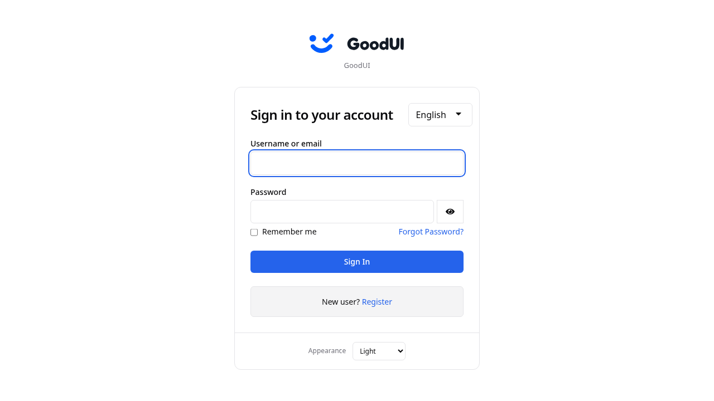
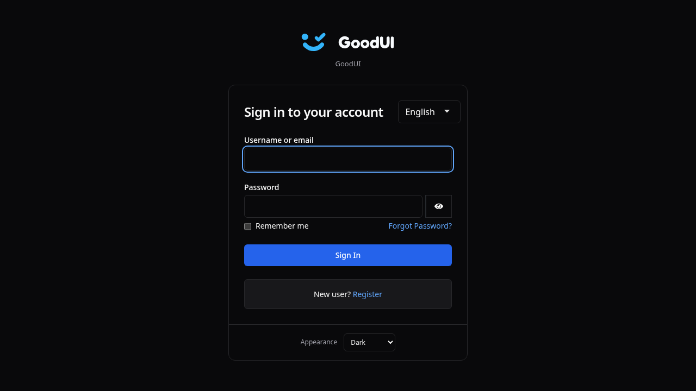

# GoodUI Keycloak Theme

Native Keycloak-Themes im Stil von [GoodUI](https://goodui.cloudfrogger.com): klare Flächen, blaue Akzente, feine Rahmen und gerundete Bedienelemente. Hell, Dunkel und automatische Systemauswahl. Ohne Angular, zusätzliche Keycloak-Erweiterung oder externe Webfonts.




## Umfang und Basis

Entwickelt und lokal getestet mit **Keycloak 26.8.2**. Die originalen Keycloak-Themes werden erweitert; Authentifizierungsabläufe und React-Konsolen bleiben Keycloak-Code.

| Bereich | Eltern-Theme | Anpassung |
| --- | --- | --- |
| Login | `keycloak.v2` | Gemeinsames Layout, GoodUI-Bedienelemente, Logos, Modusauswahl |
| Konto | `keycloak.v3` | Originale Account Console, GoodUI-Farben, Logos und Darkmode |
| Administration | `keycloak.v2` | Originale Admin Console mit GoodUI-Branding |
| E-Mail | `keycloak` | Gemeinsames HTML-Layout, Inline-Stile und Darkmode nach Mailclient |
| Willkommen | `keycloak` | Originale Willkommensseite mit GoodUI-Branding |

Das Login-Layout gilt für alle geerbten Seiten, darunter Anmeldung, Registrierung, Passwortreset/-änderung, E-Mail-Verifikation, OTP/MFA, Wiederherstellungscodes, Passkeys/WebAuthn, Identity Provider, Zustimmungs-, Fehler- und Informationsseiten. Bestehende Übersetzungen und Plaintext-E-Mails werden geerbt. Für den zusätzlichen Moduswähler sind Deutsch und Englisch enthalten; weitere Übersetzungen können in `login/messages/` ergänzt werden.

Die Account- und Admin-Konsole behalten Aufbau, Navigation und Funktionen des Originals. Ihre visuelle Anpassung erfolgt über CSS, nicht über einen eigenen React-Build. Herkunft und Version der überschriebenen Layouts stehen in [NOTICE](NOTICE). Grundlagen: [Keycloak Theme-Dokumentation](https://www.keycloak.org/ui-customization/themes), [Keycloak-Quellcode](https://github.com/keycloak/keycloak/tree/26.8.2).

## Lokal ausprobieren

Voraussetzungen: Docker mit Compose. Node.js 20+ und Python 3 werden nur für Tests beziehungsweise Paketbau benötigt.

```sh
docker compose up -d
```

Nach dem ersten Start:

- [Login, hell](http://localhost:8089/realms/goodui/protocol/openid-connect/auth?client_id=theme-preview&redirect_uri=http%3A%2F%2Flocalhost%3A8089%2Fcallback&response_type=code&scope=openid&theme_mode=light)
- [Login, dunkel](http://localhost:8089/realms/goodui/protocol/openid-connect/auth?client_id=theme-preview&redirect_uri=http%3A%2F%2Flocalhost%3A8089%2Fcallback&response_type=code&scope=openid&theme_mode=dark)
- [Konto](http://localhost:8089/realms/goodui/account/?theme_mode=dark): `demo` / `demo-change-me`
- [Administration](http://localhost:8089/admin/): `admin` / `local-admin-change-me`
- [Willkommensseite](http://localhost:8089/?theme_mode=dark)

Der Demo-Client zeigt nach erfolgreicher Anmeldung auf `/callback`; dort gibt es keine Demo-Anwendung. Die vollständige Anmeldung lässt sich über die Account Console ausprobieren.

Die Instanz lauscht ausschließlich auf `127.0.0.1:8089`. Zugangsdaten, H2-Datenbank und abgeschaltete Theme-Caches sind für lokale Entwicklung gedacht. `docker compose down` entfernt diese lokale Instanz einschließlich ihrer im Container gespeicherten Änderungen. Der Demo-Realm wird beim nächsten Start neu importiert. Bereits importierte Realms werden bei einem einfachen Neustart nicht überschrieben.

## Installation auf einem Keycloak-Server

### Verzeichnisinstallation

`themes/goodui` vollständig nach `/opt/keycloak/themes/goodui` kopieren oder als schreibgeschütztes Volume einhängen:

```yaml
volumes:
  - ./themes/goodui:/opt/keycloak/themes/goodui:ro
```

Danach unter **Realm Settings → Themes** für Login, Account, Admin und Email jeweils `goodui` auswählen. Jede Auswahl ist unabhängig. Für das Branding der Master-Administration auch im Realm `master` das Admin-Theme setzen; dessen Login-Theme bestimmt die Administrator-Anmeldeseite.

Die Willkommensseite wird serverweit aktiviert:

```sh
/opt/keycloak/bin/kc.sh start --spi-theme--welcome-theme=goodui
```

### JAR oder ZIP bauen

```sh
python3 scripts/sync-resources.py
python3 scripts/build.py
```

Der Paketbau synchronisiert die Web-Ressourcen ebenfalls automatisch. Erzeugt ohne Java-/Maven-Build:

- `dist/goodui-keycloak-theme.jar`: nach `/opt/keycloak/providers/` kopieren, anschließend `kc.sh build` ausführen und Keycloak neu starten. In einem optimierten Container das JAR **vor** dessen Build-Schritt hinzufügen.
- `dist/goodui-keycloak-theme.zip`: nach `/opt/keycloak/themes/` entpacken; enthält den Ordner `goodui/`.

Nur eine Installationsvariante für denselben Theme-Namen einsetzen. In Produktion die Standard-Caches aktiv lassen. Nach Austausch gecachter Theme-Ressourcen Keycloak neu starten und gegebenenfalls den Theme-Gzip-Cache der betroffenen Instanz erneuern. CI stellt beide Pakete als Workflow-Artefakte bereit.

## Hell-/Dunkelmodus ohne Aufblitzen

Die Anwendung hängt `theme_mode` an die **Keycloak-Autorisierungs-URL** an:

```text
https://login.example.org/realms/my-realm/protocol/openid-connect/auth
  ?client_id=my-app
  &redirect_uri=https%3A%2F%2Fapp.example.org%2Fcallback
  &response_type=code
  &scope=openid
  &theme_mode=dark
```

In der tatsächlichen URL werden keine Zeilenumbrüche oder Einrückungen verwendet.

| Wert | Verhalten |
| --- | --- |
| `light` | Helles Theme, unabhängig vom Betriebssystem |
| `dark` | Dunkles Theme, unabhängig vom Betriebssystem |
| `system` | Systempräferenz; reagiert auf Änderungen des Betriebssystems |
| Fehlt oder ungültig | Gespeicherte Auswahl, sonst Systempräferenz |

`theme-init.js` steht als **synchrones klassisches Script im Head vor allen Stylesheets**. Es setzt `data-theme`, die PatternFly-Darkmode-Klasse und `color-scheme`, bevor die Seite gerendert wird. Das originale konkurrierende Systemmodus-Script wurde aus den Layouts entfernt. Kein `async`, `defer` oder `type="module"` ergänzen. Das Script wird vom eigenen Keycloak-Host geladen und benötigt keine zusätzliche Inline-Script-Freigabe in der CSP. Die originalen Keycloak-Scripts und deren CSP-Anforderungen bleiben bestehen.

Die Auswahl wird unter `goodui-keycloak-theme-mode` in `localStorage` gespeichert, mit `sessionStorage` als Rückfall. Dadurch bleibt sie bei Formular-POSTs, Sprachwechseln und Folgeseiten erhalten, auch wenn Keycloak den beliebigen URL-Parameter dort nicht weiterträgt. Der Login-Footer erlaubt die Auswahl; bei einem Wechsel bleiben OIDC- und Sitzungsparameter erhalten. Andere Tabs übernehmen Änderungen über das Storage-Event.

Der Speicher gilt pro Browser-Origin, also für die Realms und Konsolen desselben Keycloak-Hosts. Die GoodUI-Anwendung und Keycloak auf verschiedenen Hosts teilen ihn nicht: die Anwendung muss die aktuelle Auswahl beim Login neu übergeben. Wenn der Browser beide Speicher vollständig sperrt, gilt die URL-Auswahl nur auf Seiten mit diesem Parameter; Folgeseiten verwenden sonst die Systempräferenz. E-Mails folgen ausschließlich den Fähigkeiten und Präferenzen des Mailclients.

## Farben anpassen

Die zentrale Datei für alle **Web-Seiten** ist:

```text
themes/goodui/login/resources/css/brand.css
```

Beispiel für eine violette Marke:

```css
:root {
  --good-color-brand: #7c3aed;
  --good-brand-hover: #6d28d9;
  --good-brand-foreground: #ffffff;
  --good-color-accent: #7c3aed;
}
:root[data-theme="dark"] {
  --good-color-accent: #c4b5fd;
}
```

Die vorhandenen Variablen direkt ändern. `--good-color-brand` bestimmt primäre Schaltflächen, `--good-color-accent` Links und Fokusmarkierungen. Weitere Variablen steuern Canvas, Oberfläche, Text, Rahmen, gedämpften Text, Statusfarben, Schrift, Radien und Logobreite. Für beide Modi ausreichenden Kontrast wählen. Es werden keine Fonts von Drittanbietern geladen; Inter wird verwendet, wenn lokal vorhanden, sonst die Systemschrift.

Danach die Ressourcen verteilen und neu paketieren:

```sh
python3 scripts/sync-resources.py
python3 scripts/build.py
```

Der Sync kopiert die kanonischen Dateien nach Account, Admin und Welcome. Nicht die generierten Kopien bearbeiten. Im lokalen Compose sind Änderungen unmittelbar verfügbar; bei einer produktiven Installation das vollständige Theme beziehungsweise JAR erneut ausliefern.

## Logos und Favicon anpassen

Am einfachsten diese drei Dateien ersetzen und ihre Namen beibehalten:

```text
themes/goodui/login/resources/img/goodui-logo-light.svg
themes/goodui/login/resources/img/goodui-logo-dark.svg
themes/goodui/login/resources/img/favicon.svg
```

Das helle Logo steht auf hellem Hintergrund, das dunkle auf dunklem Hintergrund. SVGs mit passender `viewBox` und transparentem Hintergrund verwenden. Die Breite lässt sich in `brand.css` über `--good-logo-width` ändern. Danach `scripts/sync-resources.py` und gegebenenfalls den Paketbau ausführen.

In `login/theme.properties` zusätzlich `brandName` für den Alternativtext setzen. Dort lassen sich auch `logoLight`, `logoDark` und `favicon` auf andere relative Dateipfade setzen. Diese abweichenden Login-Pfade gelten nur für Login: bei anderen Dateinamen auch die Logo-URLs in `css/console.css`, `welcome/index.ftl` und die `logo`-/`favIcon`-Eigenschaften in Account/Admin anpassen. Das Ersetzen unter den vorhandenen Dateinamen aktualisiert alle Web-Bereiche ohne diese zusätzlichen Änderungen.

Der kleine Name unter dem Logo kommt aus dem Anzeigenamen des Keycloak-Realms. Seitentitel, Formulartexte und Sprachen kommen weiterhin aus Keycloak.

### E-Mails branden

E-Mails verwenden bewusst eigene, mailtaugliche Inline-Stile in `themes/goodui/email/html/template.ftl`. Dort können Hintergrund, Rahmen, Schrift und die Darkmode-Farben geändert werden. `email/theme.properties` bietet:

```properties
parent=keycloak
logoUrl=https://static.example.org/brand/email-logo.png
brandColor=#7c3aed
```

`logoUrl` ist optional. Ohne URL wird nur der Realm-Name angezeigt. Für Bilder eine öffentlich erreichbare absolute HTTPS-Adresse verwenden; PNG funktioniert in vielen Mailclients zuverlässiger als SVG. Der Realm-Name wird durch Keycloak geliefert. Änderungen an Farben oder Web-Logos werden nicht automatisch in das E-Mail-Layout übertragen. Plaintext-Alternativen bleiben die Originale. Externe Bilder und Darkmode können vom Mailclient eingeschränkt werden.

## Entwicklung und Prüfung

```sh
npm ci
npm test
npm run build
npx playwright install chromium
docker compose up -d
npm run test:e2e
```

**Browsertests ausschließlich gegen die lokale Demo ausführen.** Sie setzen die Themes in `goodui` und `master` und weisen dem Demo-Benutzer Account-Rollen zu. Die Basis-URL kann für isolierte CI-Instanzen mit `KEYCLOAK_BASE_URL` überschrieben werden; sie ist kein Werkzeug zum Prüfen produktiver Realms.

Die Tests prüfen Moduspriorität, gesperrten Browser-Speicher, Systemwechsel, Erhalt von OIDC-Parametern, den ersten Paint, sichtbare Logos, fehlerhafte Anmeldung, Registrierung, Passwortreset, mobile Breite, echte Konto-/Admin-Anmeldung, Passwortänderung und vollständige TOTP-Einrichtung sowie die Willkommensseite. Lokal wurden sowohl die Verzeichnisinstallation als auch das eigenständig installierte JAR mit allen sechs Browserprüfungen getestet. Screenshots liegen in `docs/`. Die GitHub Action baut die Pakete und führt dieselben Browserprüfungen gegen Keycloak 26.8.2 aus.

Passkeys benötigen geeignete Browser-/Authenticator-Hardware; tatsächliche SMTP-Zustellung und die Darstellung in verschiedenen Mailclients sind separat zu prüfen. Diese Bereiche erben Keycloaks Implementierung und werden nicht durch die Browserprüfung allein als vollständig getestet betrachtet.

Bei einem Keycloak-Upgrade insbesondere `login/template.ftl`, `account/index.ftl`, `admin/index.ftl` und `welcome/index.ftl` gegen den jeweiligen Upstream vergleichen. Auch geerbte Formular-Klassen und die CSS-Anpassungen der React-Konsolen prüfen. Kompatibilität mit anderen Versionen wird nicht vorausgesetzt.

## Lizenz

[Apache-2.0](LICENSE); die angepassten Keycloak-Layouts stammen aus dem gleich lizenzierten Upstream. GoodUI-Logos und Farbreferenzen stammen aus dem [GoodUI-Projekt](https://github.com/cloudfrogger/goodui); dessen [MIT-Lizenz](licenses/GoodUI-MIT.txt) liegt bei. Siehe [NOTICE](NOTICE). Markenrechte werden durch diese Lizenzen nicht übertragen.
