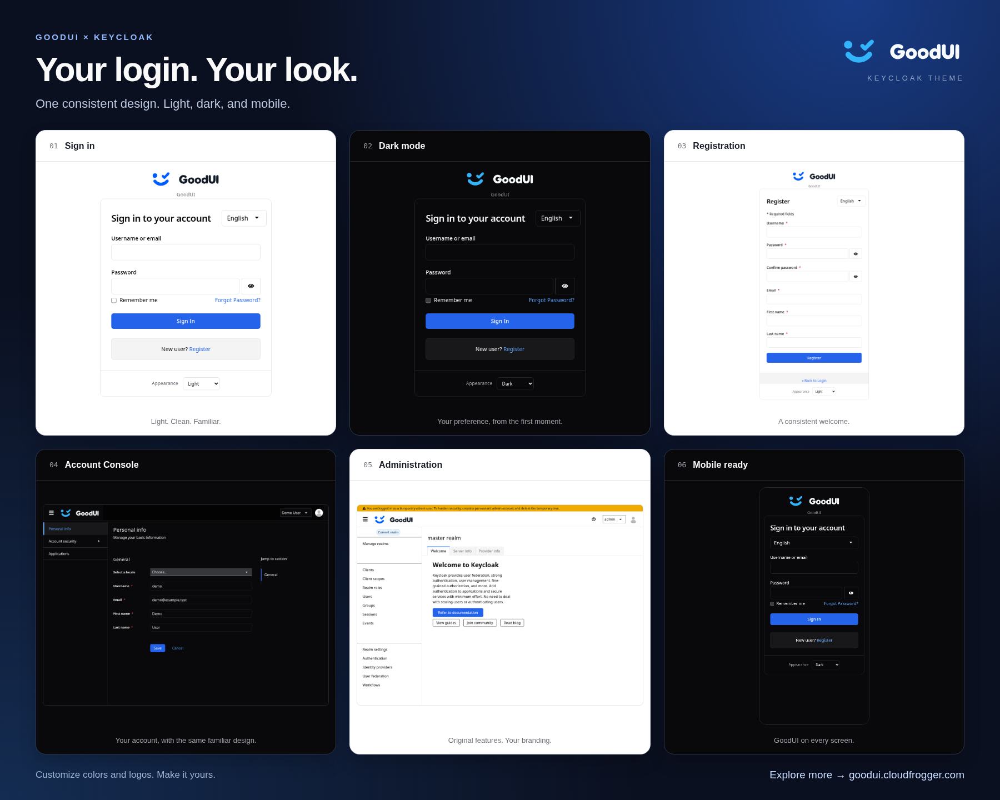
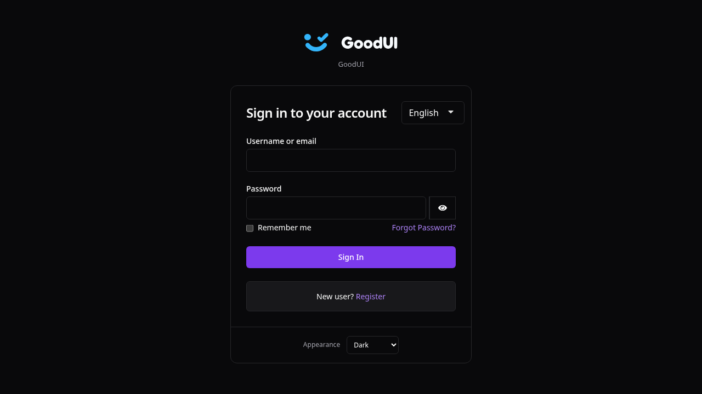

# GoodUI Keycloak Theme

[](https://drone.cloudfrogger.com/cloudfrogger/goodui_keycloak_theme)
[](https://github.com/cloudfrogger/goodui_keycloak_theme/actions/workflows/check.yml)
[](https://hub.docker.com/r/cloudfrogger/goodui-keycloak-theme)



Native Keycloak themes styled to match [GoodUI](https://goodui.cloudfrogger.com): clean surfaces, blue accents, subtle borders, and rounded controls. Includes light mode, dark mode, and automatic system preferences. No Angular application, additional Keycloak extension, or external web fonts required.

**Explore the design system behind this theme at [goodui.cloudfrogger.com](https://goodui.cloudfrogger.com), with more information about GoodUI and its components.**

## Features and compatibility

Developed and tested locally with **Keycloak 26.8.2**. The themes extend Keycloak's original themes, preserving its authentication flows and React consoles.

| Area | Parent theme | Customization |
| --- | --- | --- |
| Login | `keycloak.v2` | Shared layout, GoodUI controls, logos, and appearance selector |
| Account | `keycloak.v3` | Original Account Console with GoodUI colors, logos, and dark mode |
| Administration | `keycloak.v2` | Original Admin Console with GoodUI branding |
| Email | `keycloak` | Shared HTML layout, inline styles, and email client support for dark mode |
| Welcome | `keycloak` | Original welcome page with GoodUI branding |

The login layout applies to all inherited pages, including sign-in, registration, password resets and updates, email verification, OTP/MFA, recovery codes, passkeys/WebAuthn, identity providers, consent screens, errors, and information pages. Existing translations and plain-text emails are inherited. The additional appearance selector includes English and German translations; add other languages in `login/messages/`.

The Account and Admin Consoles retain the original layout, navigation, and features. Their appearance is customized with CSS rather than a separate React build. [NOTICE](NOTICE) records the source and version of the overridden layouts. References: [Keycloak theme documentation](https://www.keycloak.org/ui-customization/themes) and [Keycloak source code](https://github.com/keycloak/keycloak/tree/26.8.2).

## Try it locally

Requirements: Docker with Compose. Node.js 20+ and Python 3 are only required for testing and packaging.

```sh
docker compose up -d
```

After the initial startup:

- [Sign-in, light](http://localhost:8089/realms/goodui/protocol/openid-connect/auth?client_id=theme-preview&redirect_uri=http%3A%2F%2Flocalhost%3A8089%2Fcallback&response_type=code&scope=openid&theme_mode=light)
- [Sign-in, dark](http://localhost:8089/realms/goodui/protocol/openid-connect/auth?client_id=theme-preview&redirect_uri=http%3A%2F%2Flocalhost%3A8089%2Fcallback&response_type=code&scope=openid&theme_mode=dark)
- [Account Console](http://localhost:8089/realms/goodui/account/?theme_mode=dark): `demo` / `demo-change-me`
- [Administration](http://localhost:8089/admin/): `admin` / `local-admin-change-me`
- [Welcome page](http://localhost:8089/?theme_mode=dark)

After a successful sign-in, the demo client redirects to `/callback`, which does not host a demo application. Use the Account Console to try the complete sign-in flow.

The instance listens only on `127.0.0.1:8089`. Its credentials, H2 database, and disabled theme caches are intended for local development. `docker compose down` removes this local instance and any changes stored in its container. The demo realm is imported again on the next startup. Restarting an existing instance does not overwrite realms that have already been imported.

## Install on a Keycloak server

### Directory installation

Copy the entire `themes/goodui` directory to `/opt/keycloak/themes/goodui`, or mount it as a read-only volume:

```yaml
volumes:
  - ./themes/goodui:/opt/keycloak/themes/goodui:ro
```

Under **Realm Settings → Themes**, select `goodui` for Login, Account, Admin, and Email. Each selection is independent. To brand the master administration console, also set the Admin theme in the `master` realm. That realm's Login theme controls the administrator sign-in page.

Enable the welcome page server-wide:

```sh
/opt/keycloak/bin/kc.sh start --spi-theme--welcome-theme=goodui
```

### Build a JAR or ZIP

```sh
python3 scripts/sync-resources.py
python3 scripts/build.py
```

Packaging also synchronizes the web resources automatically. No Java or Maven build is required. The output includes:

- `dist/goodui-keycloak-theme.jar`: copy it to `/opt/keycloak/providers/`, run `kc.sh build`, and restart Keycloak. For an optimized container, add the JAR **before** the Keycloak build step.
- `dist/goodui-keycloak-theme.zip`: extract it into `/opt/keycloak/themes/`. The archive contains the `goodui/` directory.

Use one installation method for a given theme name. Keep the default caches enabled in production. After replacing cached theme resources, restart Keycloak and refresh the affected instance's theme gzip cache if necessary. CI provides both packages as workflow artifacts.

## Run Keycloak with Docker

### Mount the theme in an existing container

Check out this repository on the Docker host. The theme is located in `themes/goodui`. After changing the branding, run `python3 scripts/sync-resources.py` first.

Add the theme directory to the Keycloak service in your existing Compose file:

```yaml
services:
  keycloak:
    # Keep the existing image, database, environment variables, and ports.
    volumes:
      - ./goodui_keycloak_theme/themes/goodui:/opt/keycloak/themes/goodui:ro
```

The host path on the left is relative to the Compose file. Use an absolute host path if you store the repository elsewhere. The container path must be `/opt/keycloak/themes/goodui`, containing `login/`, `account/`, `admin/`, `email/`, and `welcome/` directly. Add this mount alongside existing volumes, including data volumes. Mount only this theme's subdirectory, leaving the rest of `/opt/keycloak/themes` available.

Re-create the affected service with the updated configuration:

```sh
docker compose up -d keycloak
docker compose exec keycloak ls /opt/keycloak/themes/goodui
```

Then enable `goodui` under **Realm Settings → Themes** in the target realm. Mounting the files does not change the selected theme. To use the customized welcome page, also add `--spi-theme--welcome-theme=goodui` to the existing startup arguments.

### Standalone Docker example

Run this command from the repository root:

```sh
docker run --rm --name keycloak-goodui-demo \
  -p 127.0.0.1:8091:8080 \
  -e KC_BOOTSTRAP_ADMIN_USERNAME=admin \
  -e KC_BOOTSTRAP_ADMIN_PASSWORD=local-admin-change-me \
  --mount "type=bind,source=$(pwd)/themes/goodui,target=/opt/keycloak/themes/goodui,readonly" \
  --mount "type=bind,source=$(pwd)/dev/realm.json,target=/opt/keycloak/data/import/goodui-realm.json,readonly" \
  quay.io/keycloak/keycloak:26.8.2 \
  start-dev --import-realm --spi-theme--welcome-theme=goodui
```

Open [http://localhost:8091/realms/goodui/account/?theme_mode=dark](http://localhost:8091/realms/goodui/account/?theme_mode=dark) and sign in with `demo` / `demo-change-me`. The imported demo realm already uses the theme. The `theme-preview` client remains configured for port 8089, so use the Account Console for this example. Stopping the demo removes its container; its data is not persistent. For regular operation, use your existing database and server configuration.

### Use the ready-to-run Docker Hub image

The complete Keycloak image with the theme installed is available on [Docker Hub: cloudfrogger/goodui-keycloak-theme](https://hub.docker.com/r/cloudfrogger/goodui-keycloak-theme):

```sh
docker pull cloudfrogger/goodui-keycloak-theme:26.8.2
```

The image includes Keycloak **26.8.2**, the theme JAR, an optimized Keycloak build for **PostgreSQL**, and enabled health and metrics endpoints. By default, it runs `start --optimized` with the GoodUI welcome page. It contains no users, demo passwords, or database. Supported platform: **linux/amd64**.

| Image tag | Meaning |
| --- | --- |
| `latest` | Latest successful build from `main` |
| `26.8.2` | Latest successful `main` build for this Keycloak version |
| `sha-<full-commit>` | Commit-specific tag for selecting a particular source revision |
| `0.1.0`, from Git tag `v0.1.0` | Theme version, published when the corresponding release tag is pushed |

Successful builds update `latest` and `26.8.2`. Use a commit tag or image digest to select a specific version. For `main`, published tags appear in the Drone build and on Docker Hub. Release tags also appear in the GitHub Actions run.

[compose.hub.yaml](compose.hub.yaml) provides a complete Compose example with a persistent PostgreSQL database:

```sh
cp .env.example .env
# Replace both example passwords in .env with your own passwords.
docker compose -p goodui-hub -f compose.hub.yaml up -d
docker compose -p goodui-hub -f compose.hub.yaml logs -f keycloak
```

If you already have an `.env` file, add the required values from [.env.example](.env.example) instead of replacing it. Then open [http://localhost:8091/admin/](http://localhost:8091/admin/) and enable the theme in the target realm. This example does not import demo users. The database is stored in the named volume `goodui-hub_goodui-postgres-data`, which survives a normal `docker compose down`.

If PostgreSQL is already installed, change the image of your existing Keycloak service to `cloudfrogger/goodui-keycloak-theme:26.8.2`, use `start --optimized`, and keep the existing database and secret configuration. A theme volume is no longer required. For public installations, configure the hostname and TLS/proxy settings for your environment. The Compose example listens locally on port 8091.

### Build an image with your own branding

The included [Dockerfile](Dockerfile) builds the theme directly from source, installs the JAR before `kc.sh build`, and produces the optimized runtime image. The Docker host does not need Python, Node.js, or an existing `dist/` directory:

```sh
docker build -t my-keycloak-goodui:26.8.2 .
```

Rebuild the image after changing colors or logos. To use a different database, update `KC_DB` in both Keycloak stages of the Dockerfile and rebuild. Supply credentials at runtime. The Docker build context includes only theme and build files; it excludes `.env`, Git metadata, the demo realm, and screenshots. This setup follows the [official Keycloak container documentation](https://www.keycloak.org/server/containers).

### Automated builds and Docker Hub publishing

The [Drone pipeline](.drone.yml) runs the theme tests and packages the theme for pushes to `main`. Kaniko then builds the complete Docker image and publishes it to Docker Hub. [GitHub Actions](.github/workflows/check.yml) independently checks browser flows and the optimized image with PostgreSQL. A Drone publication from `main` currently does not wait for those independent browser checks.

- Push to `main`: Drone publishes `latest`, `26.8.2`, and `sha-<commit>`.
- Push a Git tag such as `v0.1.0`: after browser checks pass, GitHub Actions publishes `0.1.0` and `sha-<commit>`, leaving `latest` unchanged.
- Pull requests and other branches: GitHub Actions builds and tests without publishing to Docker Hub.
- Manually run the GitHub workflow on `main`: run tests without publishing to Docker Hub.

For `main`, Drone uses the repository-specific encrypted `dockerhub_token` in `.drone.yml`. For release tags, GitHub Actions uses the repository variable `DOCKERHUB_USERNAME` and repository secret `DOCKERHUB_TOKEN`. In a fork, update the image names and credentials for your own Docker Hub namespace.

To repeat the image checks locally in an isolated test instance:

```sh
docker build -t goodui-keycloak-theme:test .
docker compose -p goodui-image-test -f compose.image-test.yaml up -d
# Wait until Keycloak has finished starting.
KEYCLOAK_BASE_URL=http://localhost:8092 npm run test:e2e
docker compose -p goodui-image-test -f compose.image-test.yaml down -v
```

`compose.image-test.yaml` uses local demo credentials and a separate test stack. The final `down -v` removes its test database. Never connect this test instance to a production database.

## Run Keycloak on Kubernetes with YAML

### Update an existing Keycloak deployment

The Docker Hub image already includes the theme. If your existing deployment also uses Keycloak 26.8.2 with PostgreSQL, replace its Keycloak image with the desired image version. Keep the existing database, secrets, services, and Ingress configuration. If the previous image included additional build options or extensions, include those in your custom image as well.

Changing the image does not require a realm import or a new database. After the rollout, select the `goodui` theme in each target realm. If you use a Keycloak Operator or Helm, update the image in the corresponding custom resource or Helm values so the controller preserves the change.

A Docker host path such as `./themes/goodui` cannot be used directly as a Kubernetes volume. Bundling the theme in the image makes it available on every node and in every pod, without `hostPath` or an additional persistent volume. The database still requires its own persistent storage.

### Example: Deployment, Secret, Service, and TLS Ingress

Requirements: an accessible PostgreSQL database, an installed Ingress controller, and a TLS secret for the public hostname. The public image is pulled directly from Docker Hub, so a private registry is not required. This example uses one Keycloak pod and does not configure a high-availability cluster.

Adjust these values for your environment and save the following manifest as `keycloak-goodui.yaml`:

- Use `cloudfrogger/goodui-keycloak-theme:26.8.2` or a specific commit tag from Docker Hub.
- Set the hostname `login.example.org`, Ingress class `nginx`, and TLS secret `keycloak-tls` to match your environment.
- Update the JDBC URL and credentials in `keycloak-runtime`. The PostgreSQL database must already exist.
- Bootstrap administrator credentials are used to initialize a new instance. An existing administrator account keeps its current credentials.

```yaml
apiVersion: v1
kind: Namespace
metadata:
  name: identity
---
apiVersion: v1
kind: Secret
metadata:
  name: keycloak-runtime
  namespace: identity
type: Opaque
stringData:
  KC_DB_URL: jdbc:postgresql://postgres.database.svc.cluster.local:5432/keycloak
  KC_DB_USERNAME: keycloak
  KC_DB_PASSWORD: REPLACE_WITH_DATABASE_PASSWORD
  KC_BOOTSTRAP_ADMIN_USERNAME: admin
  KC_BOOTSTRAP_ADMIN_PASSWORD: REPLACE_WITH_INITIAL_ADMIN_PASSWORD
---
apiVersion: apps/v1
kind: Deployment
metadata:
  name: keycloak
  namespace: identity
spec:
  replicas: 1
  strategy:
    type: Recreate
  selector:
    matchLabels:
      app: keycloak
  template:
    metadata:
      labels:
        app: keycloak
    spec:
      terminationGracePeriodSeconds: 60
      containers:
        - name: keycloak
          image: cloudfrogger/goodui-keycloak-theme:26.8.2
          args:
            - start
            - --optimized
            - --spi-theme--welcome-theme=goodui
          envFrom:
            - secretRef:
                name: keycloak-runtime
          env:
            - name: KC_HOSTNAME
              value: https://login.example.org
            # TLS terminates at the Ingress; it connects to Keycloak over HTTP.
            - name: KC_HTTP_ENABLED
              value: "true"
            - name: KC_PROXY_HEADERS
              value: xforwarded
          ports:
            - name: http
              containerPort: 8080
            - name: management
              containerPort: 9000
          startupProbe:
            httpGet:
              path: /health/started
              port: management
            periodSeconds: 5
            failureThreshold: 60
          readinessProbe:
            httpGet:
              path: /health/ready
              port: management
            periodSeconds: 10
          livenessProbe:
            httpGet:
              path: /health/live
              port: management
            periodSeconds: 10
          resources:
            requests:
              cpu: 500m
              memory: 512Mi
            limits:
              cpu: "2"
              memory: 1Gi
---
apiVersion: v1
kind: Service
metadata:
  name: keycloak
  namespace: identity
spec:
  selector:
    app: keycloak
  ports:
    - name: http
      port: 80
      targetPort: http
---
apiVersion: networking.k8s.io/v1
kind: Ingress
metadata:
  name: keycloak
  namespace: identity
spec:
  ingressClassName: nginx
  tls:
    - hosts:
        - login.example.org
      secretName: keycloak-tls
  rules:
    - host: login.example.org
      http:
        paths:
          - path: /
            pathType: Prefix
            backend:
              service:
                name: keycloak
                port:
                  name: http
```

The TLS secret must exist in the `identity` namespace. For a private registry, also reference an existing pull secret through `spec.template.spec.imagePullSecrets` in the Deployment. Keep files containing real passwords out of Git. Your existing secret management system can replace the Secret shown here.

The Ingress must set `X-Forwarded-*` headers correctly and overwrite matching incoming headers. Restrict access to the pod to the Ingress and required internal administration traffic. The Service exposes only the application port; management port 9000 for health and metrics is not published through the Ingress. For other TLS/proxy setups, follow the [Keycloak reverse proxy documentation](https://www.keycloak.org/server/reverseproxy). Probe endpoints are described in the [Keycloak health documentation](https://www.keycloak.org/observability/health).

After updating the placeholders and providing the database and TLS secret:

```sh
kubectl apply -f keycloak-goodui.yaml
kubectl -n identity rollout status deployment/keycloak
kubectl -n identity logs deployment/keycloak
kubectl -n identity exec deployment/keycloak -- ls /opt/keycloak/providers/
```

### Enable and update the theme

After startup, open `https://login.example.org/admin/`. Under **Realm Settings → Themes**, select `goodui` for Login, Account, Admin, and Email, then save. For the master administration console, make these selections in the `master` realm. The startup argument in the Deployment example enables the welcome page.

For automated realm provisioning, set these fields in your existing realm configuration:

```json
{
  "loginTheme": "goodui",
  "accountTheme": "goodui",
  "adminTheme": "goodui",
  "emailTheme": "goodui"
}
```

This is a configuration fragment, not a complete realm import. Update an existing realm through the Admin Console or Admin API. Restarting with `--import-realm` does not overwrite existing realms.

After changes to colors, logos, or templates, the workflow builds and publishes the updated image. Set the new **commit tag** from the CI build in your YAML file. For custom builds, assign a new image tag. Then run `kubectl apply` and `kubectl rollout status` again. All pods receive the same resources, and the new processes rebuild their theme caches. The `Recreate` strategy causes downtime during updates; use an appropriately configured Keycloak cluster for high availability.

## Light and dark modes without flashing

Your application appends `theme_mode` to the **Keycloak authorization URL**:

```text
https://login.example.org/realms/my-realm/protocol/openid-connect/auth
  ?client_id=my-app
  &redirect_uri=https%3A%2F%2Fapp.example.org%2Fcallback
  &response_type=code
  &scope=openid
  &theme_mode=dark
```

Use a single URL without line breaks or indentation in your application.

| Value | Behavior |
| --- | --- |
| `light` | Light theme, regardless of the operating system preference |
| `dark` | Dark theme, regardless of the operating system preference |
| `system` | Follow the system preference, including operating system changes |
| Missing or invalid | Use the saved preference, falling back to the system preference |

`theme-init.js` is a **synchronous classic script in the document head, before all stylesheets**. It sets `data-theme`, the PatternFly dark mode class, and `color-scheme` before the page renders. The original competing system preference script has been removed from the layouts. Do not add `async`, `defer`, or `type="module"`. The script is served by the same Keycloak host and requires no additional inline script permission in the CSP. Keycloak's original scripts and their CSP requirements still apply.

The selection is saved as `goodui-keycloak-theme-mode` in `localStorage`, with `sessionStorage` as a fallback. This preserves the mode across form submissions, language changes, and subsequent pages, even when Keycloak does not forward this custom URL parameter. The login footer provides an appearance selector; switching modes preserves OIDC and session parameters. Other tabs synchronize changes through the storage event.

Storage is scoped to the browser origin, covering realms and consoles on the same Keycloak host. A GoodUI application on a different host does not share that storage: pass its current selection again when starting sign-in. If the browser blocks both storage mechanisms, the URL selection applies only to pages containing that parameter; subsequent pages otherwise follow the system preference. Emails use the capabilities and preferences of the email client.

## Set the primary color through the URL

Pass `theme_color` alongside `theme_mode` on the Keycloak authorization URL:

```text
https://login.example.org/realms/my-realm/protocol/openid-connect/auth
  ?client_id=my-app
  &redirect_uri=https%3A%2F%2Fapp.example.org%2Fcallback
  &response_type=code
  &scope=openid
  &theme_mode=dark
  &theme_color=7c3aed
```

Use a single URL without line breaks. The color must contain **exactly six hexadecimal digits, without `#`**, such as `7c3aed` (purple) or `15803d` (green). Uppercase hexadecimal digits are also accepted. A literal `#` starts a URL fragment, so omit it rather than including it in this parameter.

When your OIDC client provides an authorization URL, add the presentation parameters while preserving its existing state, nonce, PKCE, and other parameters:

```js
const url = new URL(authorizationUrl); // Generated by your OIDC client.
url.searchParams.set('theme_mode', 'dark');
url.searchParams.set('theme_color', '7c3aed');
window.location.assign(url.href);
```

| Parameter | Result |
| --- | --- |
| `theme_color=7c3aed` | Use purple as the primary color |
| `theme_color=15803d` | Use green as the primary color |
| `theme_color=default` | Clear the saved override and use the colors from `brand.css` |
| Missing | Reuse a valid color saved for this realm in this tab, otherwise use `brand.css` |
| Invalid | Ignore the value; keep a valid saved color or the configured default |

The requested color replaces the default blue on primary buttons. Links, focus indicators, active navigation, and tab indicators use matching accents. The shared initializer applies the color **before the first paint**, across Login, Account, Admin, and Welcome. Switching light/dark modes preserves the primary color and recalculates the accent. Logo artwork and semantic status colors, such as errors and warnings, keep their own colors. Email branding remains controlled by the separate email template.

The primary button background keeps the exact requested color. Button labels automatically use black or white, and the hover background increases their contrast. Link and focus colors are adjusted for light/dark mode. Calculations target at least **4.5:1 text contrast** on the standard GoodUI canvas and selected surfaces; this is not a claim of complete WCAG conformance. If you customize surface colors in `brand.css`, verify contrast against your own backgrounds. See the [WCAG contrast guidance](https://www.w3.org/WAI/WCAG22/Understanding/contrast-minimum.html).



### Persistence and scope

The override uses **`sessionStorage`, scoped by realm**, rather than permanent `localStorage`. It survives form submissions, registration, password resets, and navigation to the Account/Admin Consoles for that realm in the same tab. Realm-specific keys also work when Keycloak uses a path prefix. The server-wide welcome page uses a separate key.

Your application should pass its chosen color or `theme_color=default` on every initial sign-in request. This explicitly replaces an earlier application's selection when multiple applications use the same realm in one tab. The value does not select a tenant or change realm configuration. Different hosts do not share the override; your application must manage its own colors separately.

If session storage is blocked, a valid URL color still applies to the current page. Subsequent pages without that parameter use the configured default. Previously published Docker images do not gain this feature automatically: deploy a newly built theme or image containing this initializer.

### Input validation and security

The implementation accepts only `[0-9a-fA-F]{6}` or the explicit reset value `default`. Saved values are validated again when read. Color names, shorthand/alpha colors, CSS declarations, functions such as `url(...)`, HTML, and JavaScript are rejected.

Only four fixed CSS custom properties are written through `style.setProperty`, using normalized or calculated hexadecimal colors. The value never becomes HTML, a stylesheet, a selector, a resource URL, or executable code. There are no new dependencies, network requests, server endpoints, or CSP relaxations. This follows the [OWASP guidance on safe CSS property values](https://cheatsheetseries.owasp.org/cheatsheets/Cross_Site_Scripting_Prevention_Cheat_Sheet.html#output-encoding-for-css-contexts).

This parameter controls appearance only. A color is not proof of application identity or authorization. Authentication actions, redirect validation, sessions, MFA, and OIDC security remain Keycloak's responsibility and are unchanged by the color override.

## Customize colors

The central branding file for all **web pages** is:

```text
themes/goodui/login/resources/css/brand.css
```

For example, to use a purple brand color:

```css
:root {
  --good-color-brand: #7c3aed;
  --good-brand-hover: #6d28d9;
  --good-brand-foreground: #ffffff;
  --good-color-accent: #7c3aed;
}
:root[data-theme="dark"] {
  --good-color-accent: #c4b5fd;
}
```

Edit the existing variables directly. `--good-color-brand` controls primary buttons; `--good-color-accent` controls links and focus indicators. Other variables control the canvas, surfaces, text, borders, muted text, status colors, font, corner radii, and logo width. Choose sufficient contrast in both modes. No third-party fonts are downloaded: Inter is used when installed locally, with system fonts as a fallback.

Then synchronize the resources and rebuild the packages:

```sh
python3 scripts/sync-resources.py
python3 scripts/build.py
```

The synchronization script copies the canonical files to Account, Admin, and Welcome. Edit the source files rather than the generated copies. Changes are available immediately in the local Compose setup. For production, deploy the updated theme directory or JAR.

## Customize logos and the favicon

The easiest option is to replace these three files while keeping their names:

```text
themes/goodui/login/resources/img/goodui-logo-light.svg
themes/goodui/login/resources/img/goodui-logo-dark.svg
themes/goodui/login/resources/img/favicon.svg
```

The light logo appears on light backgrounds, and the dark logo appears on dark backgrounds. Use SVGs with an appropriate `viewBox` and a transparent background. Adjust `--good-logo-width` in `brand.css` to change the width. Then run `scripts/sync-resources.py` and rebuild the packages if needed.

Set `brandName` in `login/theme.properties` to customize the image alt text. You can also set `logoLight`, `logoDark`, and `favicon` to other relative file paths. These custom paths apply only to Login. If you use different filenames, also update the logo URLs in `css/console.css` and `welcome/index.ftl`, plus the `logo` and `favIcon` properties for Account and Admin. Replacing the files under their existing names updates all web areas without those extra changes.

The small name below the logo comes from the Keycloak realm's display name. Page titles, form labels, and languages continue to come from Keycloak.

### Brand your emails

Emails use a separate layout with email-compatible inline styles in `themes/goodui/email/html/template.ftl`. Customize the background, borders, font, and dark mode colors there. `email/theme.properties` supports:

```properties
parent=keycloak
logoUrl=https://static.example.org/brand/email-logo.png
brandColor=#7c3aed
```

`logoUrl` is optional. When it is empty, the heading displays only the realm name. Use a publicly accessible absolute HTTPS URL for images. PNG works more reliably than SVG in many email clients. Keycloak supplies the realm name. Web color and logo changes are not automatically applied to the email layout. Plain-text alternatives remain the originals. Email clients may restrict external images and dark mode support.

## Development and verification

```sh
npm ci
npm test
npm run build
npx playwright install chromium
docker compose up -d
npm run test:e2e
```

**Run browser tests only against the local demo.** They set themes in `goodui` and `master`, configure the demo client's redirect URL, and assign account roles to the demo user. Override the base URL with `KEYCLOAK_BASE_URL` for isolated CI instances. These tests are not intended for production realms.

The tests cover URL color validation, CSS/HTML injection payload rejection, color persistence and reset, realm isolation, derived text contrast, colored console navigation, mode priority, blocked browser storage, system preference changes, preserved OIDC parameters, the first paint, visible logos, invalid credentials, registration, password resets, mobile widths, real Account/Admin sign-in, password updates, complete TOTP enrollment, and the welcome page. Both directory installation and standalone JAR installation have been tested locally with the browser test suite. Screenshots are stored in `docs/`. GitHub Actions builds the packages and runs the same browser checks against Keycloak 26.8.2, then tests the production image with PostgreSQL. Release tags are published after those checks; Drone publishes `main` independently as described above.

Passkeys require appropriate browser/authenticator hardware. Actual SMTP delivery and rendering in different email clients require separate testing. These areas inherit Keycloak's implementation; browser checks alone do not establish that they have been fully tested.

When upgrading Keycloak, compare `login/template.ftl`, `account/index.ftl`, `admin/index.ftl`, and `welcome/index.ftl` with the corresponding upstream files. Also review inherited form classes and the CSS overrides for the React consoles. Compatibility with other versions is not assumed.

The collage at the top of this README uses real screenshots of the local Keycloak demo. With the demo running and Playwright installed, regenerate it after design changes:

```sh
node scripts/create-collage.mjs
```

The script uses only `http://localhost:8089`, signs in with the local demo accounts, and saves individual views in `docs/views/` and the collage as `docs/theme-collage.png`. It captures the UI in American English and does not change realm settings.

## License

[Apache-2.0](LICENSE). The adapted Keycloak layouts come from the upstream project under the same license. GoodUI logos and color references come from the [GoodUI project](https://github.com/cloudfrogger/goodui); its [MIT license](licenses/GoodUI-MIT.txt) is included. See [NOTICE](NOTICE). These licenses do not grant trademark rights.
